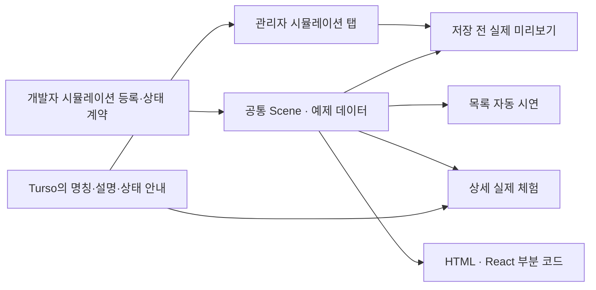

# UI 확장 구현·콘텐츠·검토 명세

작성일: 2026-11-28 · 상태: **실무 UI 우선의 제작 기획안** · 선행 자료: [277개 비교 조사](reference-gap-analysis-2026-11-28.md)

## 이번 기획의 범위

신규 UI 24개와 기존 UI 보강 12개 묶음을 1차로 제작한다. 이후 신규 24개를 2차로 다룬다. 남은 신규 동작 48개·비교 학습 83개·보류 2개는 전체 백로그에 남긴다. 이 문서와 JSON은 기획 자료이며 실행 소스·콘텐츠 시드·Turso에 바로 가져올 백업 파일이 아니다.

현재 밝은 프론트 디자인, 다크 관리자, 넓은 PC 3~4열, 모바일 카드, 전체 카드 링크, 자동 반복 시연, 고정 제목·닫기 버튼이 있는 상세 모달을 유지한다. 1차 추가는 현재 카테고리 안에 배치하며 기존 UI의 순서·분류를 임의로 바꾸지 않는다.

## 카테고리와 콘텐츠 종류

| 단계 | 카테고리 정책 | 콘텐츠 표시 |
| --- | --- | --- |
| 1차 | 기존 11개 카테고리를 유지 | 24개 새 UI는 입력·선택·레이어·피드백·탐색·조작·레이아웃 주제로 배치 |
| 2차 | 필요한 시점에 ‘페이지 구성과 랜딩’ 추가 | Hero·기능 소개·가격표·CTA 등을 목적이 있는 구성으로 제공 |
| 후속 학습 | ‘스타일과 시각 표현’, ‘디자인 기초’ 추가 검토 | 같은 문구·데이터에서 전후 비교·값 조절로 차이를 학습. 불필요한 로딩/성공 상태를 억지로 붙이지 않음 |
| 검색 | 현재 카테고리 다중 선택 규칙 보존 | 종류 메타데이터는 component/pattern/layout/motion/style/foundation으로 제안. 1차 UI 추가의 필수 DB 변경으로 묶지 않음 |

## 선행 작업 A0: 상태 선택과 실제 체험의 연결

현재 통합된 시뮬레이션 관리 화면은 목록 시연·기본 체험·상태별 설명을 한곳에서 보여준다. 다만 체험 상태를 고르면 `SimulationStateScreen`의 설명용 화면이 나타나며 기본 실행 Scene 자체를 해당 상태로 바꾸는 계약은 아직 없다. **새 UI는 이 설명용 화면을 또 복제하지 않고 실제 체험 Scene과 상태 설명이 함께 바뀌도록 먼저 연결한다.**

1. 개발자가 각 데모에 허용할 안정적인 상태 키를 선언한다. 예: `default`, `query-empty`, `request-failed`, `selection-limit`. 상태의 제목·발생 조건·처리 설명은 관리자에서 편집한다. 새로운 동작 상태는 소스 등록 후 선택할 수 있다.
2. `SimulationExperience`가 선택한 상태 키를 검증한 뒤 iframe에 전달한다. 허용 명령·nonce·메시지 source를 검사하고 임의 JavaScript 문자열은 실행하지 않는다.
3. React entry와 독립 HTML 실행 함수가 같은 fixture·상태 계약을 사용한다. 예를 들어 조회 실패를 고르면 실제 목록 컴포넌트가 실패 상태로 바뀌고 재시도 버튼도 동작해야 한다.
4. 사용자가 체험으로 상태를 바꾸면 설명의 현재 상태도 동기화한다. 설명을 고르는 것이 내부 폼 값을 불필요하게 전부 지우지 않도록 reset과 scenario 변경을 구분한다.
5. 기존 77개의 임의 예시 ID를 라벨 추측으로 재매핑하지 않는다. 먼저 신규 24개에 계약을 적용하고, 기존은 일치가 확인된 상태부터 명시적으로 연결한다. 매핑 전의 기존 안내 화면은 설명용임을 유지한다.
6. 관리자 상태 편집은 허용 키의 문구/설명/데이터 옵션에 한정한다. 소스에 없는 키는 저장·게시 검증에서 알려야 하며 ‘설명만 추가’와 ‘실제 동작 상태 추가’를 혼동하지 않게 한다.

## 목록 시연과 실제 체험의 공통 규칙

- 목록과 ‘동작 살펴보기’는 자동 루프다. 플레이·별도 모션 감소 버튼은 다시 추가하지 않는다. 화면 밖·숨겨진 브라우저 탭의 프레임 처리는 내부에서 멈춘다. OS 모션 선호에 대한 CSS 처리는 별도 노출 버튼 없이 검토한다.
- 목록은 실제 Scene의 축소된 preview 모드에서 그린다. 목록용 장면과 모달용 장면을 서로 다른 임의 그림으로 만들지 않는다. 모바일 대체가 필요하면 같은 데이터·문구·행동 순서를 유지한다.
- 24개 기본 루프는 4.8초·4단계로 제안한다. 각 단계의 정확한 시점은 구현 시 duration/poster/steps와 검수 영상으로 맞춘다. 이 시간은 표준 수치가 아니다.
- 실제 체험은 로컬 예제 데이터와 지연/실패 옵션으로 완결한다. 외부 SNS 전송·SMS·실제 결제·사용자 계정 생성은 하지 않는다. 자료를 다운로드/복사하는 동작은 실제 성공·실패를 구분한다.
- 입력이 생기는 곳은 기존 글자/UTF-8 byte 측정 함수를 재사용한다. OTP 등 형식 입력의 자릿수는 별도로 명확히 표시하고 숫자 값을 단순 텍스트 길이 제한과 혼동하지 않는다.
- 저장·선택·보관처럼 지속되는 상태는 강조가 유지된다. 복사·공유 대상 실행·단순 완료 알림은 일회성 피드백이며 눌림 상태로 계속 칠하지 않는다. hover·focus·pressed·disabled는 구분한다.
- 화살표·체크박스·아이콘은 텍스트의 세로 중앙에 맞춘다. 긴 라벨은 줄바꿈하고 전체 카드·모달·코드 영역에 뜻하지 않은 가로 스크롤이 생기지 않게 한다. Scroll Snap 데모의 내부 가로 스크롤은 의도된 상호작용으로 예외다.
- 작은 UI는 체험 영역 가운데, 긴 목록·폼은 위에 정렬한다. 모달 높이를 항목마다 바꾸지 않고 제목·닫기 버튼을 고정한다.

## 상세 원고·직무 안내·코드의 완료 조건

| 항목 | 작성 기준 |
| --- | --- |
| 명칭 | 영문·한국어 발음·한국어 표현·별칭·실제 움직임 검색어. 통칭과 특정 패턴을 구분 |
| 사용 추천 | 추상적인 정의보다 실무 과업과 선택 이유를 먼저 설명. 적합하지 않은 상황도 함께 제시 |
| 대안 | 대안의 차이와 선택 조건을 적고, 게시된 대상의 애니메이션 카드 + 밑줄 제목 + ‘바로가기’로 연결. 아직 제작되지 않은 후속 후보는 예정 문구로만 표시하고 유효하지 않은 모달 링크를 만들지 않음 |
| 상태 설명 | 언제 나타나는가 / 화면에서 무엇이 달라지는가 / 사용자는 무엇을 할 수 있는가 / 실패 시 무엇을 보존하는가 |
| 기획자 | 입력·노출·권한·빈 결과·오류·복구의 업무 규칙과 전달 산출물을 구체적으로 작성 |
| 디자이너 | 기본/hover/focus/선택/비활성/진행/오류 상태, 길이·밀도·기기 대체와 아이콘 정렬을 함께 정의 |
| 퍼블리싱·프론트엔드 | 시맨틱 구조·키보드·초점·읽기 순서·반응형·모션과 cleanup을 설명. HTML/CSS/JS 부분 코드 제공 |
| 개발자 | 값 모델·ID·검증·비동기 경쟁·중복 요청·재시도·롤백을 설명. React/TypeScript 부분 코드 제공 |
| 코드 | 기본은 해당 UI 조각. React+CSS, HTML+CSS+JS를 분리하고 전체 문서는 명시적으로 ‘전체 예제’ 선택 시만 표시. 줄바꿈과 복사 후 독립 실행을 검증 |
| 기기 | PC/모바일의 적용 가능성과 입력 방식을 따로 표기. 모바일 권장이라는 이유로 PC 전용/불가를 임의 지정하지 않음 |

## 1차 제작 순서와 검토 게이트

| 묶음 | 신규 UI | 선행·함께 할 보강 | 종료 기준 |
| --- | --- | --- | --- |
| A0 | 실제 상태 연동 계약·원본 재사용 | 기존 입력 측정·아이콘·초점/프레임 계약 정리 | 실제 상태 선택→Scene 변경→조작 결과→설명 동기화. React/HTML 모두 확인 |
| A1 · 기본 요소/메뉴 6개 | badge, chip-tag, avatar, command-palette, context-menu, split-button | E01 Dropdown, E03 버튼 | 선택 지속/일회성 피드백과 메뉴 초점/닫기 동작이 일치 |
| A2 · 입력 6개 | password-field, otp-input, multi-select, number-stepper, time-picker, rating | E04 입력 안내, E05 동의, E06 첨부 | IME·붙여넣기·경계값·검증·글자/byte·모바일 키보드 검증 |
| A3 · 업무 흐름 6개 | notification-center, hover-card, inline-edit, infinite-scroll, swipe-actions, pull-to-refresh | E07 표, E08 필터, E09 공유 | 읽음/저장/조회/삭제 실패 및 복구, 단순 버튼 대체까지 검증 |
| A4 · 배치/스크롤 6개 | split-view, mega-menu, scroll-reveal, stagger-animation, scroll-snap, parallax-scroll | E02 Drawer, E10 진행률, E11 헤더, E12 Confetti | 드래그/스크롤·모바일 대체·화면 밖 정지·목록/상세 형태 일치 |

달력 일정·리치 텍스트 편집·차트·동영상처럼 자체 범위가 큰 UI는 1차에 묶지 않는다. 각 묶음의 검수에서 새 상태나 반응형 예외가 발견되면 남은 항목을 늘리기 전에 해당 계약부터 수정한다.

## 신규 24개 상세 제작 카드

### 01. Badge — 숫자·상태 표시

ID: `badge` · 발음: 배지 · 카테고리: 피드백과 상태 · 상태: 기획

| 구분 | 구현·원고 명세 |
| --- | --- |
| 정의/추천 | 미확인 알림 수나 목록 항목의 상태처럼 짧은 요약을 기존 대상 옆에 붙일 때 사용한다. 중요한 오류 본문은 배지만으로 대체하지 않는다. |
| 별칭 | Notification Badge · 카운트 배지 · 상태 배지 |
| 동작 검색어 | 종 위에 숫자 · 작은 빨간 점 · 99플러스 |
| 목록 자동 루프 | 알림 0개 → 새 알림 3개 → 미확인 100개 이상 → 모두 읽어 0개 (4.8초 제안) |
| 직접 체험 | 알림 추가·한 개 읽기·모두 읽기·0개 표시 옵션으로 숫자와 점 형태를 비교한다. 137개는 화면에 99+로 보이되 접근 가능한 이름에는 실제 개수를 담는다. |
| 필수 상태 | 0개·숨김/표시 / 1~99개 / 100개 이상 / 텍스트 상태 |
| 기기/대체 | PC·모바일 공통. 배지를 직접 누르기보다 알림 버튼의 넉넉한 영역으로 진입한다. |
| 키보드/초점 | 실행 버튼은 Tab/Enter/Space로 조작한다. 숫자 변화마다 초점을 옮기지 않는다. |
| 대안 연결 | notification-center, inline-alert, status-indicator |
| 부분 코드 범위 | Badge.tsx + badge.css / badge markup·style·script. 실제 개수·상한·표시 문구를 분리한다. |

**직무별 원고에 반드시 포함할 내용**

- **기획**: 무엇을 세는지·0개 정책·읽음 처리 시점을 문서화한다.
- **디자인**: 색 외에 숫자/문구를 제공하고 아이콘 중심선과 배지 기준점을 확인한다.
- **퍼블리싱·프론트엔드**: 실제 개수와 표현용 문자열을 분리하고 무조건 aria-live를 붙이지 않는다.
- **개발**: 목록 읽음과 개수의 데이터 기준을 맞추며 중복 알림을 집계하지 않는다.

**완료 확인**: 0→1→99→100 경계 / 읽음 후 숫자 감소 / 점만 있어도 의미 전달 / 카드와 상세의 크기·숫자 규칙 일치.

### 02. Chip / Tag — 선택·제거 가능한 작은 항목

ID: `chip-tag` · 발음: 칩 / 태그 · 카테고리: 실행과 선택 · 상태: 기획

| 구분 | 구현·원고 명세 |
| --- | --- |
| 정의/추천 | 적용한 검색 조건이나 여러 선택값을 짧게 보여줄 때 적합하다. 단순 분류 태그와 누르는 선택 칩은 같은 동작으로 보이지 않게 구분한다. |
| 별칭 | Filter Chip · Token · 삭제 가능한 태그 |
| 동작 검색어 | 작은 둥근 라벨 · 엑스로 지우는 태그 · 선택 필터 알약 |
| 목록 자동 루프 | 정적 태그와 선택 칩 → 한 칩 선택 → 선택한 칩 삭제 → 원래 항목 복귀 (4.8초 제안) |
| 직접 체험 | 보기 전용·선택·삭제 세 형태를 전환한다. 선택은 강조가 유지되고 삭제는 항목을 없앤다. 전체 초기화와 최대 선택 수 예제를 제공한다. |
| 필수 상태 | 기본 / 선택됨 / 삭제 가능 / 비활성·선택 한도 |
| 기기/대체 | PC·모바일 공통. X가 작아도 실제 삭제 버튼 영역은 충분히 확보한다. |
| 키보드/초점 | 선택 버튼은 Space/Enter, 삭제 버튼은 독립된 Tab 대상이다. 삭제 후 다음 항목이나 입력으로 초점을 돌린다. |
| 대안 연결 | checkbox, multi-select, filtering |
| 부분 코드 범위 | Tag, ChoiceChip, RemovableChip을 역할별로 분리한다. 한 버튼 안에 삭제 버튼을 중첩하지 않는다. |

**직무별 원고에 반드시 포함할 내용**

- **기획**: 정적 분류·필터 적용·선택값 제거 중 어떤 역할인지 정한다.
- **디자인**: 읽기 전용에는 가짜 hover를 주지 않고 선택/삭제 상태를 구분한다.
- **퍼블리싱·프론트엔드**: aria-pressed는 선택 칩에만 연결하고 삭제 버튼 이름에 항목명을 넣는다.
- **개발**: 식별자를 기준으로 선택·해제하며 라벨 변경이 선택값을 깨지 않게 한다.

**완료 확인**: 같은 항목 중복 선택 방지 / 삭제 아이콘 가로세로 중앙 / 선택 강조 지속 / 태그가 여러 줄로 자연스럽게 배치.

### 03. Avatar — 사용자 식별 이미지

ID: `avatar` · 발음: 아바타 · 카테고리: 정보 구조와 콘텐츠 · 상태: 기획

| 구분 | 구현·원고 명세 |
| --- | --- |
| 정의/추천 | 작성자·참여자·담당자를 빠르게 구별할 때 사용한다. 아바타 그림만으로 사용자 이름이나 온라인 상태를 전달하지 않는다. |
| 별칭 | Profile Image · Avatar Group · 프로필 이미지 |
| 동작 검색어 | 동그란 프로필 · 사용자 이니셜 · 겹친 프로필 더보기 |
| 목록 자동 루프 | 사용자 이미지 → 이미지 실패로 이니셜 → 참여자 그룹 → 초과 인원 펼침 (4.8초 제안) |
| 직접 체험 | 이미지 정상/실패를 전환하고 단일·그룹 표시를 비교한다. 그룹의 +3을 누르면 전체 참여자 목록을 기존 Popover 형태로 연다. |
| 필수 상태 | 이미지 정상 / 이니셜 대체 / 이름도 없음 / 그룹 인원 초과 |
| 기기/대체 | PC·모바일 공통. 작은 원 전체가 클릭 대상이며 hover만으로 이름을 제공하지 않는다. |
| 키보드/초점 | 보기 전용 이미지는 불필요한 Tab 대상에서 제외한다. +N 버튼은 Enter/Space, 펼친 목록은 Esc로 닫는다. |
| 대안 연결 | card, list, popover |
| 부분 코드 범위 | Avatar.tsx, AvatarGroup.tsx, 이미지 실패 처리와 이니셜 계산을 부분 코드에 포함한다. 이미지 자산은 프로젝트 소유 예제를 사용한다. |

**직무별 원고에 반드시 포함할 내용**

- **기획**: 공개할 이름·그룹 최대 표시 수·정보 미제공 정책을 정한다.
- **디자인**: 사진 비율·이니셜 중심·겹침·상태 점 위치를 비교한다.
- **퍼블리싱·프론트엔드**: 이미지 실패를 처리하고 인접 이름이 있을 때 대체 텍스트 중복을 피한다.
- **개발**: 이미지 URL과 이름의 갱신 기준을 맞추고 실패한 자원을 반복 요청하지 않는다.

**완료 확인**: onError 무한 반복 없음 / 한글/영문/빈 이름 대체 / 겹침 순서와 +N 숫자 / 그룹 목록 키보드 진입·복귀.

### 04. Command Palette — 검색으로 실행하는 명령창

ID: `command-palette` · 발음: 커맨드 팔레트 · 카테고리: 탐색과 이동 · 상태: 기획

| 구분 | 구현·원고 명세 |
| --- | --- |
| 정의/추천 | 메뉴와 기능이 많은 업무 도구에서 목적지를 빠르게 찾거나 명령을 실행할 때 추천한다. 정해진 소수 옵션 하나를 고르는 폼에는 Select가 더 단순하다. |
| 별칭 | Command Menu · 커맨드 K · 명령 검색창 |
| 동작 검색어 | 컨트롤 케이 · 메뉴 검색해서 실행 · 단축키 검색창 |
| 목록 자동 루프 | 실행 버튼/단축키 → 명령어 입력 → 방향키로 선택 → 실행 후 결과 안내 (4.8초 제안) |
| 직접 체험 | 열기 버튼과 체험 iframe 내부 Ctrl+K/Cmd+K로 연다. 페이지 이동·테마 변경·새 문서의 로컬 명령 8개를 검색하고 실행한다. 단축키는 전체 사이트를 가로채지 않는다. |
| 필수 상태 | 추천 명령 / 검색 일치 / 검색 결과 없음 / 로딩/실행 실패 |
| 기기/대체 | PC·모바일 공통. 모바일은 명확한 열기 버튼과 세로 목록을 제공하며 가상 키보드 위에서 현재 항목이 잘리지 않게 한다. |
| 키보드/초점 | 위·아래 이동, Enter 실행, Esc는 내부 팔레트만 닫고 원래 실행 버튼으로 복귀한다. IME 조합 중 Enter는 실행하지 않는다. |
| 대안 연결 | combobox, menu-button, search-field |
| 부분 코드 범위 | Dialog·검색 입력·결과 목록·명령 레지스트리·모의 실행 함수를 함께 제공한다. 명령 ID와 화면 라벨을 분리한다. |

**직무별 원고에 반드시 포함할 내용**

- **기획**: 명령과 페이지 이동을 분류하고 권한·검색 제외 대상을 정의한다.
- **디자인**: 그룹 제목·단축키·선택 행의 위계를 구분한다.
- **퍼블리싱·프론트엔드**: 모달과 검색형 목록의 역할·초점·활성 항목을 동기화한다.
- **개발**: 표시 문구를 실행 코드로 평가하지 않고 허용된 명령 ID만 호출한다.

**완료 확인**: 빈 검색어 추천 / 한글 입력 조합 / 결과 변경 후 활성 인덱스 보정 / Esc가 바깥 용어 모달을 닫지 않음 / 실행 실패 후 창·입력 유지.

### 05. Context Menu — 대상에 맞춰 여는 작업 메뉴

ID: `context-menu` · 발음: 컨텍스트 메뉴 · 카테고리: 레이어와 도움말 · 상태: 기획

| 구분 | 구현·원고 명세 |
| --- | --- |
| 정의/추천 | 파일·문서·행처럼 특정 대상의 복수 행동을 짧게 제공할 때 사용한다. 모든 사용자가 우클릭을 알 것이라 가정하지 않고 보이는 더보기 버튼을 함께 둔다. |
| 별칭 | Right-click Menu · 우클릭 메뉴 · 문맥 메뉴 |
| 동작 검색어 | 오른쪽 클릭 메뉴 · 길게 누르면 메뉴 · 마우스 위치 메뉴 |
| 목록 자동 루프 | 문서 행 → 포인터 위치에서 열기 → 복사/보관 선택 → 닫기와 결과 (4.8초 제안) |
| 직접 체험 | 정해진 문서 영역의 우클릭, 보이는 더보기 버튼, Shift+F10으로 연다. 복사·이름 변경·보관을 모의 처리하고 화면 모서리에서는 메뉴 위치를 보정한다. |
| 필수 상태 | 열기 전 / 작업 목록 / 실행 불가 항목 / 보관 후 취소 |
| 기기/대체 | PC 우클릭 중심이지만 모바일은 더보기 버튼/선택 시트로 같은 행동을 제공한다. 길게 누르기는 보조 입력으로만 둔다. |
| 키보드/초점 | 위·아래, Home/End, Enter, Esc를 지원한다. 닫히면 대상 문서 행으로 복귀한다. |
| 대안 연결 | menu-button, popover, bottom-sheet |
| 부분 코드 범위 | 앵커 좌표 보정·바깥 클릭·키보드 처리·메뉴 항목 실행을 포함한다. 전역 contextmenu를 무조건 막지 않는다. |

**직무별 원고에 반드시 포함할 내용**

- **기획**: 대상별 가능한 작업·위험 작업·실행 불가 이유를 정의한다.
- **디자인**: 일반/위험/비활성 행을 색만으로 구별하지 않는다.
- **퍼블리싱·프론트엔드**: pointer와 keyboard 좌표 기준을 나누고 Esc·바깥 클릭을 정리한다.
- **개발**: 작업 대상 ID를 유지하고 메뉴가 열린 뒤 대상이 없어질 경우를 처리한다.

**완료 확인**: 네 모서리에서 잘림 없음 / 영역 밖 기본 우클릭 유지 / 비활성 항목 실행 차단 / 닫은 뒤 초점 복귀 / 복사 강조가 계속 남지 않음.

### 06. Split Button — 기본 실행과 추가 옵션을 나눈 버튼

ID: `split-button` · 발음: 스플릿 버튼 · 카테고리: 실행과 선택 · 상태: 기획

| 구분 | 구현·원고 명세 |
| --- | --- |
| 정의/추천 | 가장 자주 쓰는 실행과 그 파생 작업을 붙여 보여줄 때 사용한다. 두 영역이 모두 같은 메뉴만 연다면 일반 Menu Button이 더 적절하다. |
| 별칭 | 분할 실행 버튼 · Dropdown Button · 복합 버튼 |
| 동작 검색어 | 저장 옆 아래 화살표 · 버튼 반쪽 메뉴 · 기본 실행 추가 옵션 |
| 목록 자동 루프 | 기본 저장 버튼 → 화살표로 옵션 열기 → 사본 저장 선택 → 완료 후 기본 상태 (4.8초 제안) |
| 직접 체험 | 왼쪽은 저장을 실행하고 오른쪽은 다른 이름으로 저장·사본 저장 메뉴만 연다. 요청 중 중복 실행을 막고 결과는 일시 알림으로 보여준다. |
| 필수 상태 | 기본 / 옵션 메뉴 열림 / 저장 중 / 완료/실패 |
| 기기/대체 | PC·모바일 공통. 화살표 영역을 독립된 충분한 클릭 영역으로 만든다. |
| 키보드/초점 | 두 버튼은 각각 Tab 대상이다. 기본 실행은 Enter/Space, 메뉴는 위·아래·Enter·Esc를 지원한다. |
| 대안 연결 | button, menu-button, segmented-control |
| 부분 코드 범위 | 기본 action과 menu action을 분리한다. 일회성 저장 성공을 aria-pressed나 영구 선택 색상으로 표현하지 않는다. |

**직무별 원고에 반드시 포함할 내용**

- **기획**: 기본 행동과 파생 행동의 실행 결과를 명확히 나눈다.
- **디자인**: 경계선·합쳐진 외곽선·화살표 영역의 크기를 정의한다.
- **퍼블리싱·프론트엔드**: 중첩 버튼을 피하고 각 버튼의 이름·확장 상태를 제공한다.
- **개발**: 실행별 핸들러와 로딩 상태를 분리하고 중복 요청을 방지한다.

**완료 확인**: 기본 실행이 메뉴를 열지 않음 / 화살표가 저장하지 않음 / 중복 클릭 한 번만 처리 / 실패 후 재시도 / 아이콘과 라벨 수직 중앙.

### 07. Password Field — 보기·숨기기가 있는 비밀번호 입력

ID: `password-field` · 발음: 패스워드 필드 · 카테고리: 입력과 검색 · 상태: 기획

| 구분 | 구현·원고 명세 |
| --- | --- |
| 정의/추천 | 로그인이나 새 암호 입력에서 입력 오류를 줄일 때 사용한다. 화면에 보이는 예제 조건과 실제 서비스의 암호 정책은 별개임을 표시한다. |
| 별칭 | Password Input · 암호 입력 · 비밀번호 표시 |
| 동작 검색어 | 눈 아이콘 입력창 · 비밀번호 보이기 · 암호 조건 안내 |
| 목록 자동 루프 | 가려진 입력 → 일부 입력과 조건 안내 → 눈 버튼으로 보기 → 다시 가리기 (4.8초 제안) |
| 직접 체험 | 가상의 예제 암호를 입력하고 표시/숨김을 바꾼다. 로그인용/새 암호용을 전환해 도움말과 자동완성 속성의 차이를 보여준다. 실제 관리자 암호는 사용하지 않는다. |
| 필수 상태 | 빈 입력 / 가림 / 보임 / 예제 조건 미충족/충족 |
| 기기/대체 | PC·모바일 공통. 표시 버튼을 눌러도 입력 위치와 값이 보존된다. |
| 키보드/초점 | 입력 후 Tab으로 표시 버튼 이동, Enter/Space로 전환한다. 붙여넣기와 비밀번호 관리자의 입력을 막지 않는다. |
| 대안 연결 | text-field, auth-form, otp-input |
| 부분 코드 범위 | type=password/text 전환, current-password/new-password 설정, 조건 안내·오류 연결을 포함한다. 입력값을 로그나 영구 저장소에 남기지 않는다. |

**직무별 원고에 반드시 포함할 내용**

- **기획**: 로그인과 새 암호 설정의 조건·오류 문구를 구분한다.
- **디자인**: 눈 아이콘의 현재 동작 이름과 도움말 위치를 정한다.
- **퍼블리싱·프론트엔드**: 보기 버튼 type=button·accessible name·설명 연결을 구현한다.
- **개발**: 실제 인증과 예제 검증을 분리하고 화면 표시와 서버 정책을 일치시킨다.

**완료 확인**: 한글/기호/붙여넣기 / 보기 전환 시 선택 위치 유지 / 조건 결과 텍스트 제공 / 표시 버튼이 폼 제출하지 않음.

### 08. OTP / PIN Input — 인증번호 입력

ID: `otp-input` · 발음: 오티피 / 핀 인풋 · 카테고리: 입력과 검색 · 상태: 기획

| 구분 | 구현·원고 명세 |
| --- | --- |
| 정의/추천 | 한 번 받은 짧은 인증 코드를 입력할 때 사용한다. 예제의 성공 코드·만료 시간은 모의 값이며 실제 인증이나 문자 전송을 하지 않는다. |
| 별칭 | One-time Code · 인증 코드 · 6자리 입력 |
| 동작 검색어 | 인증번호 여섯 칸 · 번호 붙여넣기 · 문자 자동완성 |
| 목록 자동 루프 | 빈 여섯 칸 → 숫자 입력 → 전체 코드 완성 → 성공/오류 후 초기화 (4.8초 제안) |
| 직접 체험 | 시각적으로 6칸이지만 실제 입력은 하나로 구현해 붙여넣기·자동완성·커서 편집을 유지한다. 예제 코드 123456은 성공, 다른 값은 실패하며 만료·재전송도 모의 처리한다. |
| 필수 상태 | 입력 중 / 6자리 완료 / 코드 불일치 / 만료·재전송 대기 |
| 기기/대체 | PC·모바일 공통. inputmode=numeric과 autocomplete=one-time-code를 사용하고 각 칸을 별도 접근성 항목으로 반복 읽지 않는다. |
| 키보드/초점 | 문자 입력·전체 붙여넣기·방향키·Backspace를 네이티브 입력처럼 유지한다. 조합 중 Enter로 제출하지 않는다. |
| 대안 연결 | text-field, password-field, auth-form |
| 부분 코드 범위 | 단일 input과 장식 슬롯, 자리 수 검증, 모의 만료/재전송 타이머 정리를 포함한다. |

**직무별 원고에 반드시 포함할 내용**

- **기획**: 유효 시간·재전송 대기·실패 시 다음 행동을 정한다.
- **디자인**: 현재 입력 위치·에러·시간 정보를 분리하고 가로 잘림을 확인한다.
- **퍼블리싱·프론트엔드**: 선행 0을 보존하는 문자열로 관리하고 자동완성·붙여넣기를 허용한다.
- **개발**: 코드 검증·만료·횟수 제한은 실제 서비스에서 서버가 맡으며 예제 타이머와 혼동하지 않게 한다.

**완료 확인**: 붙여넣기 6자리 일괄 반영 / 중간 숫자 수정 / 앞자리 0 보존 / 길이 초과·비숫자 / 재전송 연타와 타이머 정리.

### 09. Multi-select / Tag Input — 여러 값을 고르는 검색 입력

ID: `multi-select` · 발음: 멀티 셀렉트 / 태그 인풋 · 카테고리: 입력과 검색 · 상태: 기획

| 구분 | 구현·원고 명세 |
| --- | --- |
| 정의/추천 | 담당자·분류·태그처럼 여러 값을 검색해서 고를 때 사용한다. 옵션 수가 적고 설명이 중요하면 Checkbox가 더 쉽게 비교된다. |
| 별칭 | Token Input · 복수 선택 콤보박스 · 태그 입력 |
| 동작 검색어 | 여러 개 선택해서 칩 · 검색하고 태그 추가 · 엑스로 선택 제거 |
| 목록 자동 루프 | 검색 입력과 후보 → 디자인 선택 → 개발 추가로 칩 두 개 → 칩 제거 (4.8초 제안) |
| 직접 체험 | 기획·디자인·프론트엔드·백엔드 4개 후보에서 최대 3개를 선택한다. 자유 입력 허용은 별도 옵션으로 비교하고 기본은 등록된 값만 허용한다. 선택된 항목을 다시 골라도 중복되지 않는다. |
| 필수 상태 | 아무것도 선택 안 함 / 검색 일치/없음 / 복수 선택 / 최대 수 도달·중복 |
| 기기/대체 | PC·모바일 공통. 선택 칩은 여러 줄로 감싸며 목록은 뷰포트 안에 둔다. |
| 키보드/초점 | 위·아래로 후보 이동·Enter 선택·Esc 닫기. 빈 입력에서 Backspace는 마지막 칩에 초점을 보내고 Delete로 제거한다. |
| 대안 연결 | combobox, checkbox, chip-tag |
| 부분 코드 범위 | 필터링·선택 ID 배열·칩·후보 목록·활성 인덱스·자유 입력 정책을 포함한다. 단일 Combobox의 값 모델을 그대로 재사용하지 않는다. |

**직무별 원고에 반드시 포함할 내용**

- **기획**: 등록 옵션·자유 입력·중복·최대 선택 수를 정한다.
- **디자인**: 선택/검색/비활성/한도 상태를 정의하고 칩이 많아도 입력이 보이게 한다.
- **퍼블리싱·프론트엔드**: 검색 결과와 활성 인덱스를 동기화하고 선택·삭제 버튼을 중첩하지 않는다.
- **개발**: 표시 라벨과 안정적인 옵션 ID를 나누며 중복/정규화 규칙을 양쪽 코드에서 공유한다.

**완료 확인**: 서울 입력 오류처럼 검색 외 후보가 섞이지 않음 / IME 조합 중 잘못 선택 안 됨 / 중복·최대 수 / 칩 삭제 후 초점 / HTML/React 동일 결과.

### 10. Number Stepper / Spinbutton — 증감 버튼이 있는 숫자 입력

ID: `number-stepper` · 발음: 넘버 스테퍼 / 스핀버튼 · 카테고리: 입력과 검색 · 상태: 기획

| 구분 | 구현·원고 명세 |
| --- | --- |
| 정의/추천 | 상품 수량처럼 작은 범위의 정수를 자주 증감할 때 적합하다. 큰 범위의 대략적인 값을 고를 때는 Slider를 비교한다. |
| 별칭 | Quantity Input · 수량 입력 · 숫자 스피너 |
| 동작 검색어 | 플러스 마이너스 수량 · 숫자 하나씩 증가 · 최소 최대 수량 |
| 목록 자동 루프 | 수량 1 → 플러스로 2 → 직접 입력해 10 → 최대 제한 후 원복 (4.8초 제안) |
| 직접 체험 | 최소 1·최대 10·간격 1의 예제로 시작한다. +/- 버튼과 직접 입력을 함께 제공하며 입력 중 빈 문자열을 즉시 0으로 바꾸지 않는다. 단계 진행기 Stepper와 별개 용어로 설명한다. |
| 필수 상태 | 최솟값 / 정상 값 / 최댓값 / 빈 값·범위 밖·숫자 아님 |
| 기기/대체 | PC·모바일 공통. 양쪽 버튼과 입력의 세로 중심을 맞추고 숫자 키보드를 사용한다. |
| 키보드/초점 | 입력의 위·아래 키로 증감, Home/End는 커스텀 spinbutton을 쓸 경우에만 명시적으로 구현한다. 네이티브 input 사용을 우선한다. |
| 대안 연결 | text-field, slider |
| 부분 코드 범위 | 입력 문자열·유효 숫자·commit 검증을 나누고 min/max/step·disabled 버튼 상태를 연결한다. |

**직무별 원고에 반드시 포함할 내용**

- **기획**: 단위·초깃값·간격·범위 밖 입력 처리 시점을 정한다.
- **디자인**: 증감 버튼·중앙 입력·비활성 상태의 폭과 중심을 맞춘다.
- **퍼블리싱·프론트엔드**: type=number를 우선하고 빈 문자열 편집과 제출용 값을 분리한다.
- **개발**: 소수/재고/상한 등 업무 검증은 화면 제한과 별도로 확인한다.

**완료 확인**: 최소/최대에서 버튼 제한 / 소수/음수/빈 입력 / 길게 누르기 미지원이면 안내 / 버튼 연타 / Step 진행기와 검색 충돌 없음.

### 11. Time Picker — 시각 선택기

ID: `time-picker` · 발음: 타임 피커 · 카테고리: 입력과 검색 · 상태: 기획

| 구분 | 구현·원고 명세 |
| --- | --- |
| 정의/추천 | 예약·알람처럼 하루 중 시각을 선택할 때 사용한다. 날짜와 시간대가 중요하면 날짜 선택 및 시간대 안내를 함께 제공한다. |
| 별칭 | 시간 피커 · 예약 시간 입력 · Time Slot Picker |
| 동작 검색어 | 시 분 선택 · 예약 가능한 시간 · 시간 목록 |
| 목록 자동 루프 | 시간 미선택 → 시간 후보 열기 → 사용 가능 슬롯 선택 → 선택 완료 (4.8초 제안) |
| 직접 체험 | 09:00~18:00을 30분 간격으로 제공하고 12:00~13:00은 예약 불가 예제로 둔다. HH:mm 직접 입력과 목록 선택을 모두 체험한다. 24시간/오전·오후 표시를 비교한다. |
| 필수 상태 | 미선택 / 사용 가능 / 예약 불가 / 잘못된 시각·범위 밖 |
| 기기/대체 | PC·모바일 공통. 좁은 폭에서는 세로 슬롯 목록 또는 네이티브 입력 대안을 제공한다. |
| 키보드/초점 | 후보 위·아래 이동, Enter 선택, Esc 닫기. 입력 모드에서는 시·분 편집을 방해하지 않는다. |
| 대안 연결 | select, date-picker, date-range-picker |
| 부분 코드 범위 | HH:mm 파싱·분 단위 비교·불가 슬롯 검증·표시 변환을 독립 함수로 제공한다. 시간대를 임의로 바꾸지 않는다. |

**직무별 원고에 반드시 포함할 내용**

- **기획**: 영업 시간·예약 간격·불가 시간·시간대 기준을 정한다.
- **디자인**: 선택/예약 불가·현재값·오전/오후를 일관되게 표시한다.
- **퍼블리싱·프론트엔드**: 시간을 Date 문자열 추측 파싱에 맡기지 않고 시/분 값으로 검증한다.
- **개발**: 가용 슬롯과 서버 시간대·마감 기준을 명시해 표시값과 저장값을 맞춘다.

**완료 확인**: 09:00/18:00 경계 / 12:00 불가 / 24:00·9:77 오류 / 직접 입력과 목록 같은 값 / 모바일 목록 잘림 없음.

### 12. Rating — 별점 입력과 평점 표시

ID: `rating` · 발음: 레이팅 · 카테고리: 입력과 검색 · 상태: 기획

| 구분 | 구현·원고 명세 |
| --- | --- |
| 정의/추천 | 적은 수의 단계로 만족도를 평가할 때 사용한다. 정밀한 수치나 서로 다른 평가 항목은 Select·설문을 비교한다. |
| 별칭 | Star Rating · 별점 · 평가 점수 |
| 동작 검색어 | 별 다섯 개 · 별점 선택 · 평점 표시 |
| 목록 자동 루프 | 아직 평가 안 함 → 세 번째 별 미리보기 → 별점 3 선택 → 지우기 (4.8초 제안) |
| 직접 체험 | 입력용 1~5점과 읽기 전용 4.5/5·리뷰 120개 표시를 전환한다. hover 미리보기와 실제 선택을 구분하고 삭제 버튼으로 미선택에 돌아간다. |
| 필수 상태 | 미선택 / hover 미리보기 / 선택됨 / 읽기 전용·비활성 |
| 기기/대체 | PC·모바일 공통. 터치에서는 hover를 요구하지 않고 누른 점수를 즉시 표시한다. |
| 키보드/초점 | 라디오 그룹의 화살표 이동·Space 선택을 사용한다. 지우기 버튼은 별도 Tab 대상이다. |
| 대안 연결 | radio-group, slider, segmented-control |
| 부분 코드 범위 | 입력 radio 그룹과 정적 평점 표시를 분리하고 텍스트 점수·별 개수·반별 표시를 동기화한다. |

**직무별 원고에 반드시 포함할 내용**

- **기획**: 평가 척도·반점 허용·미응답 처리·리뷰 수 기준을 정한다.
- **디자인**: hover와 확정·비활성·반별·숫자 표기의 시각 차이를 정의한다.
- **퍼블리싱·프론트엔드**: input용 radio와 읽기용 텍스트를 분리하고 별 모양만으로 점수를 전달하지 않는다.
- **개발**: 선택값과 집계 평점을 구분하고 중복 제출/편집 가능 조건을 정한다.

**완료 확인**: hover 후 떠나면 기존 선택 복귀 / 선택 색 유지 / 지우기 0점과 미선택 구분 / 읽기 전용을 클릭 가능하게 보이지 않음.

### 13. Notification Center — 알림 목록 패널

ID: `notification-center` · 발음: 노티피케이션 센터 · 카테고리: 피드백과 상태 · 상태: 기획

| 구분 | 구현·원고 명세 |
| --- | --- |
| 정의/추천 | 사용자가 나중에 다시 확인해야 할 알림을 모아 보여줄 때 사용한다. 잠깐 결과만 알려주려면 Toast나 Snackbar가 더 간단하다. |
| 별칭 | Inbox Panel · 알림함 · 알림 센터 |
| 동작 검색어 | 종 누르면 목록 · 읽지 않은 알림 · 모두 읽음 |
| 목록 자동 루프 | 종에 미확인 숫자 → 알림 목록 열기 → 하나 읽어 개수 감소 → 모두 읽음 (4.8초 제안) |
| 직접 체험 | 알림 5개·미확인 3개로 시작한다. 개별 읽음/모두 읽음·전체/미확인 필터·목록 비움·조회 실패를 모의 처리한다. 항목 열기와 읽음 변경은 구분한다. |
| 필수 상태 | 미확인 있음 / 전체 읽음 / 빈 목록 / 조회 중·실패 |
| 기기/대체 | PC는 앵커 패널, 모바일은 너비에 맞춘 시트/전면 패널 대안을 사용한다. |
| 키보드/초점 | 열기 버튼 Tab/Enter, 항목은 자연스러운 Tab 순서, Esc로 닫고 종 버튼으로 돌아간다. |
| 대안 연결 | popover, toast, list, badge |
| 부분 코드 범위 | 읽음 ID 집합·배지 개수·필터·모의 요청·패널 위치·초점 복귀를 포함한다. |

**직무별 원고에 반드시 포함할 내용**

- **기획**: 보관 기간·읽음 기준·항목 이동·모두 읽음 범위를 정의한다.
- **디자인**: 미확인·읽음·긴 제목·시간 표기의 위계를 정한다.
- **퍼블리싱·프론트엔드**: 배지와 목록 상태를 하나의 데이터에서 파생하고 초점 이동을 유지한다.
- **개발**: 읽음 처리와 페이지 커서를 동기화하고 실패 시 롤백/재시도를 제공한다.

**완료 확인**: 읽음에 맞는 배지 감소 / 미확인 필터에서 읽으면 다음 항목 유지 / 실패해도 기존 목록 보존 / 모바일 패널이 버튼을 가리지 않음.

### 14. Hover Card — 대상의 상세 미리보기 카드

ID: `hover-card` · 발음: 호버 카드 · 카테고리: 레이어와 도움말 · 상태: 기획

| 구분 | 구현·원고 명세 |
| --- | --- |
| 정의/추천 | 사용자·문서·링크를 떠나기 전에 짧은 구조화 정보를 확인할 때 적합하다. 필수 안내나 자주 눌러야 하는 행동은 기본 화면에 둔다. |
| 별칭 | Preview Card · 링크 미리보기 · 프로필 미리보기 |
| 동작 검색어 | 마우스 올리면 프로필 · 링크 미리보기 카드 · 툴팁보다 큰 설명 |
| 목록 자동 루프 | 사용자 이름 → hover/초점 진입 → 카드에 상세 정보 → 떠나면 닫기 (4.8초 제안) |
| 직접 체험 | 사용자 이름에 hover·초점·탭하면 이름·역할·짧은 소개를 보여준다. 카드 안으로 포인터를 옮겨도 바로 사라지지 않으며 고정해서 보기와 닫기를 제공한다. |
| 필수 상태 | 닫힘 / 열림 / 고정됨 / 내용 없음·이미지 실패 |
| 기기/대체 | PC hover는 보조 입력이다. 모바일은 탭으로 열고 명시적 닫기를 제공한다. 카드가 화면 경계를 넘지 않게 배치한다. |
| 키보드/초점 | 초점으로 같은 정보를 열고 Esc로 닫는다. 내부 링크가 있으면 Tooltip 역할을 쓰지 않고 접근 가능한 Popover로 취급한다. |
| 대안 연결 | tooltip, popover, card |
| 부분 코드 범위 | 열기/닫기 지연·trigger/card 포인터 경계·외부 클릭·경계 보정·타이머 정리를 포함한다. |

**직무별 원고에 반드시 포함할 내용**

- **기획**: 미리보기에 필수 정보가 숨지 않는지·카드 내부 행동 여부를 결정한다.
- **디자인**: 이름·이미지·보조 정보의 위계와 화살표 위치를 맞춘다.
- **퍼블리싱·프론트엔드**: Tooltip/Popover 의미를 구분하고 지연 타이머를 정리한다.
- **개발**: 대상 ID 변경 시 오래된 응답이 새 대상 카드에 표시되지 않도록 한다.

**완료 확인**: 트리거→카드 이동 시 안 닫힘 / 키보드 접근과 Esc / 빠른 대상 이동 시 이전 카드 잔상 없음 / 모바일 탭 가능.

### 15. Inline Edit — 화면 안에서 바로 수정

ID: `inline-edit` · 발음: 인라인 에디트 · 카테고리: 입력과 검색 · 상태: 기획

| 구분 | 구현·원고 명세 |
| --- | --- |
| 정의/추천 | 짧은 이름·수량·설명 하나를 문맥을 잃지 않고 수정할 때 사용한다. 여러 필드나 검토 단계가 필요하면 모달/전용 폼을 사용한다. |
| 별칭 | Editable Label · 제자리 편집 · Click to Edit |
| 동작 검색어 | 글자 누르면 입력 · 수정 후 저장 취소 · 제자리 이름 변경 |
| 목록 자동 루프 | 읽기 전용 제목 → 수정 눌러 입력 → 저장 진행 → 새 제목 반영 (4.8초 제안) |
| 직접 체험 | 문서 제목 옆 수정 버튼으로 편집한다. Enter·저장으로 확정, Esc·취소로 원복한다. 실패 시 편집값을 유지하고 재시도한다. 기본은 blur만으로 자동 저장하지 않는다. |
| 필수 상태 | 읽기 / 편집 / 저장 중 / 저장 실패·취소 |
| 기기/대체 | PC·모바일 공통. 짧은 텍스트 옆 편집 버튼에 충분한 클릭 영역을 두고 키보드가 올라와도 저장/취소가 보이게 한다. |
| 키보드/초점 | 수정 버튼 Enter, 편집 중 Esc 취소, Enter 저장. IME 조합 중 Enter는 확정만 하고 저장하지 않는다. |
| 대안 연결 | text-field, modal, data-grid |
| 부분 코드 범위 | committed/draft 값·요청 상태·초점 복귀·비교 변경 여부를 나누고 기존 InputMetrics로 글자/byte를 표시한다. |

**직무별 원고에 반드시 포함할 내용**

- **기획**: 즉시 저장/명시 저장·빈 값·취소·권한 규칙을 정한다.
- **디자인**: 읽기/편집/진행/오류 상태에서도 요소 높이가 크게 흔들리지 않게 한다.
- **퍼블리싱·프론트엔드**: 저장값과 임시값을 나누고 조합 입력·초점 복귀를 처리한다.
- **개발**: 이전 버전 기준 충돌과 서버 실패를 표시하고 최신 값으로 덮어쓰기 전 검토한다.

**완료 확인**: 취소 후 원문 그대로 / 실패 후 값 유지 / IME 저장 오작동 없음 / 중복 저장 차단 / 값이 같으면 불필요한 요청 없음.

### 16. Infinite Scroll — 스크롤로 이어서 불러오기

ID: `infinite-scroll` · 발음: 인피니트 스크롤 · 카테고리: 조작과 데이터 탐색 · 상태: 기획

| 구분 | 구현·원고 명세 |
| --- | --- |
| 정의/추천 | 피드처럼 연속 탐색이 중요한 목록에 적합하다. 특정 페이지 재방문·전체 개수·하단 정보 접근이 중요하면 Pagination이나 Load More를 비교한다. |
| 별칭 | 무한 스크롤 · Endless Scroll · Auto Load More |
| 동작 검색어 | 아래로 내리면 계속 나옴 · 끝에 가면 자동 로딩 · 무한 목록 |
| 목록 자동 루프 | 초기 6개 목록 → 하단 경계 진입 → 다음 항목 조회 → 추가 후 탐색 계속 (4.8초 제안) |
| 직접 체험 | 모의 데이터 18개를 6개씩 조회한다. 하단 감지·요청 중·실패/재시도·마지막 페이지를 제공하고 자동 불러오기 끄기/더보기 대체를 비교한다. 초기화 외에는 기존 항목을 지우지 않는다. |
| 필수 상태 | 초기 조회 / 다음 페이지 대기 / 추가 조회 실패 / 더 이상 없음 |
| 기기/대체 | PC·모바일 공통. 체험 내부 스크롤을 사용하고 실제 사이트 전체 스크롤을 가로채지 않는다. |
| 키보드/초점 | 추가 항목이 생겨도 현재 초점을 이동하지 않는다. 키보드 사용자는 더보기/재시도 버튼으로 같은 결과를 얻는다. |
| 대안 연결 | load-more, pagination, list |
| 부분 코드 범위 | IntersectionObserver root·pending 잠금·cursor·중복 제거·abort/cleanup·기존 항목 유지·fallback 버튼을 포함한다. |

**직무별 원고에 반드시 포함할 내용**

- **기획**: 탐색 목적·재방문·하단 정보 접근·한 번에 불러올 양을 정한다.
- **디자인**: 추가 로딩·오류·마지막 항목 안내를 목록 흐름 안에 배치한다.
- **퍼블리싱·프론트엔드**: 관찰 대상을 정리하고 비동기 잠금을 중복 프레임에도 유지한다.
- **개발**: 안정적인 커서와 중복 제거 기준을 제공하고 실패한 페이지를 안전하게 재요청한다.

**완료 확인**: 빠른 스크롤 중 중복 요청 없음 / 실패해도 페이지 커서가 넘어가지 않음 / 동일 ID 중복 없음 / 끝난 뒤 재요청 없음 / 초점·스크롤 위치 유지.

### 17. Swipe Actions — 행을 밀어 실행 버튼 드러내기

ID: `swipe-actions` · 발음: 스와이프 액션 · 카테고리: 조작과 데이터 탐색 · 상태: 기획

| 구분 | 구현·원고 명세 |
| --- | --- |
| 정의/추천 | 메일·메모 같은 반복 목록의 보조 작업을 빠르게 실행할 때 사용한다. 발견하기 어려우므로 동일 작업의 보이는 메뉴나 버튼도 제공한다. |
| 별칭 | Swipe to Delete · 밀어서 삭제 · 행 스와이프 |
| 동작 검색어 | 옆으로 밀면 삭제 · 메일 행 밀기 · 손가락 따라오는 행 |
| 목록 자동 루프 | 닫힌 행 → 행을 왼쪽으로 끌기 → 보관/삭제 버튼 노출 → 삭제 후 실행 취소 (4.8초 제안) |
| 직접 체험 | 행이 마우스/손가락 이동량을 따라온다. 일정 거리 이하로 놓으면 원래 위치, 이상이면 행동이 열린다. 열기만으로 삭제하지 않고 삭제 버튼을 눌러 실행한다. 삭제 직후 취소를 제공한다. |
| 필수 상태 | 닫힘 / 끌기 중 / 행동 노출 / 삭제됨·복원 |
| 기기/대체 | 모바일 중심이지만 PC 드래그도 지원한다. 세로 스크롤 의도를 먼저 구분하고 터치 취소 시 원복한다. |
| 키보드/초점 | 행의 더보기 버튼과 독립 작업 버튼으로 같은 작업을 수행한다. Esc는 열린 행을 닫는다. |
| 대안 연결 | menu-button, context-menu, list |
| 부분 코드 범위 | pointer capture·가로/세로 의도 판별·변위 제한·pointercancel·삭제/복원·대체 메뉴를 공통 실행 함수로 제공한다. |

**직무별 원고에 반드시 포함할 내용**

- **기획**: 밀기 방향·노출 행동·삭제 확정·실행 취소 시간을 정한다.
- **디자인**: 드래그 거리와 배경 행동 노출을 일치시키고 위험 행동을 구분한다.
- **퍼블리싱·프론트엔드**: pointercancel과 세로 스크롤을 처리하며 드래그 없는 대체 조작을 제공한다.
- **개발**: 항목 ID와 원래 위치를 보관하고 삭제 실패 시 되돌릴 수 있게 한다.

**완료 확인**: 누른 위치와 카드가 함께 이동 / 세로 스크롤 방해 없음 / 포인터 이탈·취소 원복 / 한 행만 열림 / 버튼으로 같은 행동 가능 / 복원 위치 유지.

### 18. Pull to Refresh — 당겨서 새로고침

ID: `pull-to-refresh` · 발음: 풀 투 리프레시 · 카테고리: 조작과 데이터 탐색 · 상태: 기획

| 구분 | 구현·원고 명세 |
| --- | --- |
| 정의/추천 | 모바일 피드에서 최신 목록을 명시적으로 다시 가져올 때 사용한다. 입력 폼이나 중간 스크롤 위치에서는 강제 갱신을 피한다. |
| 별칭 | 당겨서 갱신 · 끌어서 새로고침 · Pull-down Refresh |
| 동작 검색어 | 맨 위에서 당기기 · 놓으면 새로고침 · 당기면 로딩 원 |
| 목록 자동 루프 | 목록 맨 위 → 아래로 당겨 표시기 등장 → 임계점 후 놓기 → 새 항목 반영 (4.8초 제안) |
| 직접 체험 | 체험 스크롤의 맨 위에서만 당기기를 시작한다. 미달하면 취소하고 충분히 당긴 뒤 놓으면 모의 조회한다. 새로고침 버튼으로 동일 동작을 수행하며 실패 시 기존 데이터를 유지한다. |
| 필수 상태 | 대기 / 당기는 중 / 놓으면 갱신 / 조회 중·완료/실패 |
| 기기/대체 | 모바일 권장. PC에는 보이는 새로고침 버튼을 제공하고 마우스 드래그는 체험 보조 방식으로 둔다. 브라우저 전체 새로고침과 분리한다. |
| 키보드/초점 | 새로고침 버튼 Enter/Space가 같은 요청 함수를 실행한다. 완료 시 초점은 유지한다. |
| 대안 연결 | button, infinite-scroll, loading-spinner |
| 부분 코드 범위 | scrollTop 조건·저항값·임계 거리·pointercancel·요청 잠금·오류 복구를 포함한다. |

**직무별 원고에 반드시 포함할 내용**

- **기획**: 최신 순서·갱신 범위·기존 목록 보존·최종 갱신 시각을 정한다.
- **디자인**: 당기기/놓기/조회 중 문구와 위치를 연속적으로 설계한다.
- **퍼블리싱·프론트엔드**: 상단 제스처만 가로채고 취소·관성 스크롤·정리를 처리한다.
- **개발**: 새 데이터 병합과 중복 제거·실패 시 복원 정책을 정의한다.

**완료 확인**: 중간 스크롤에서 실행 안 됨 / 임계점 미달 취소 / 놓기 전 요청 없음 / 진행 중 중복 요청 차단 / 기존 목록 보존 / 실제 iOS/Android 후속 확인.

### 19. Split View / Resizable Panels — 폭을 조절하는 분할 화면

ID: `split-view` · 발음: 스플릿 뷰 / 리사이저블 패널 · 카테고리: 레이아웃과 모션 · 상태: 기획

| 구분 | 구현·원고 명세 |
| --- | --- |
| 정의/추천 | 편집기와 결과 화면처럼 두 내용을 동시에 비교할 때 사용한다. 좁은 화면에서 양쪽을 억지로 유지하기보다 Tabs나 순차 화면을 제공한다. |
| 별칭 | Window Splitter · Resizable Panels · 분할 패널 |
| 동작 검색어 | 가운데 선 끌어 넓이 조절 · 좌우 패널 · 분할 편집 화면 |
| 목록 자동 루프 | 기본 50:50 패널 → 분할선 잡기 → 폭이 포인터 따라 변함 → 최소 폭에서 정지 (4.8초 제안) |
| 직접 체험 | 편집 내용과 결과를 좌우로 배치하고 분할선을 끌어 비율을 바꾼다. 25/50/75% 버튼과 초기화도 제공한다. 작은 폭에서는 세로 배치 또는 탭 보기로 전환한다. |
| 필수 상태 | 기본 비율 / 드래그 중 / 최소·최대 폭 / 작은 화면 대체 |
| 기기/대체 | PC 동시 비교 권장. 모바일에는 세로 배치/탭 전환으로 내용을 보존한다. 기기 전용으로 차단하지 않는다. |
| 키보드/초점 | 분할선에 초점을 두고 좌·우 키로 비율 조절, Home/End는 허용 최소/최대로 이동한다. 비율 버튼도 제공한다. |
| 대안 연결 | tabs, responsive-layout, list-detail |
| 부분 코드 범위 | separator 의미·현재 비율·pointer capture·패널 최소 폭·resize 반응·버튼 대체를 포함한다. |

**직무별 원고에 반드시 포함할 내용**

- **기획**: 동시 비교 필요성·패널 우선순위·최소 폭·접힘 조건을 정한다.
- **디자인**: 손잡이 시인성·히트 영역·중심선·모바일 대체를 정의한다.
- **퍼블리싱·프론트엔드**: separator의 값·제어 대상과 실제 크기를 동기화하고 키보드 조절을 구현한다.
- **개발**: 패널 크기 변경으로 편집 데이터가 초기화되지 않게 상태와 레이아웃을 분리한다.

**완료 확인**: 분할선이 포인터와 일치 / 내용 최소 폭 보호 / 키보드와 버튼 조절 / 작은 화면 가로 잘림 없음 / 드래그 취소와 초기화.

### 20. Mega Menu — 여러 그룹으로 펼치는 큰 탐색 메뉴

ID: `mega-menu` · 발음: 메가 메뉴 · 카테고리: 탐색과 이동 · 상태: 기획

| 구분 | 구현·원고 명세 |
| --- | --- |
| 정의/추천 | 여러 목적지를 주제별로 묶어 한 번에 보여주는 사이트 탐색에 적합하다. 항목이 적거나 한 가지 작업만 있으면 Menu Button이 더 간단하다. |
| 별칭 | 확장 탐색 메뉴 · 다열 메뉴 · Large Navigation Menu |
| 동작 검색어 | 큰 메뉴 판 · 메뉴 여러 열 · 상단 누르면 대형 메뉴 |
| 목록 자동 루프 | 상단 탐색 → 제품 그룹 열림 → 그룹 안 목적지 초점 → 선택 후 닫힘 (4.8초 제안) |
| 직접 체험 | 제품·자료·지원 3개 그룹을 버튼으로 열고 내부 문서 링크를 선택한다. 예제 내 목적지로만 이동한다. hover 열기는 선택 옵션이며 클릭과 키보드는 항상 동작한다. |
| 필수 상태 | 닫힘 / 그룹 열림 / 현재 목적지 / 모바일 접힘 메뉴 |
| 기기/대체 | PC 다열 패널, 모바일은 그룹별 세로 Disclosure 또는 Drawer로 대체한다. |
| 키보드/초점 | 사이트 링크 탐색에는 자연스러운 Tab 순서를 사용하고 Esc로 닫는다. 앱의 menubar 키 모델을 무조건 적용하지 않는다. |
| 대안 연결 | menu-button, navigation-drawer, accordion |
| 부분 코드 범위 | nav·disclosure 버튼·그룹 링크·aria-expanded·현재 위치·외부 클릭·반응형 배치를 포함한다. |

**직무별 원고에 반드시 포함할 내용**

- **기획**: 목적지 그룹과 계층·현재 위치·모바일 노출 순서를 정한다.
- **디자인**: 열 너비·그룹 제목·긴 라벨·포인터 이동 경로를 설계한다.
- **퍼블리싱·프론트엔드**: 내비게이션 링크와 실행 메뉴의 의미를 구분하고 숨긴 링크를 Tab에서 제외한다.
- **개발**: 목적지 정보와 권한을 데이터로 관리하고 보이지 않는 링크의 이동 경로를 검증한다.

**완료 확인**: 열린 패널이 잘리지 않음 / 클릭·초점·터치 동일 접근 / 그룹 바꿀 때 깜빡임 없음 / 현재 위치 표시 / 모바일 읽기 순서 유지.

### 21. Scroll Reveal — 스크롤 진입 시 나타나는 콘텐츠

ID: `scroll-reveal` · 발음: 스크롤 리빌 · 카테고리: 레이아웃과 모션 · 상태: 기획

| 구분 | 구현·원고 명세 |
| --- | --- |
| 정의/추천 | 섹션 경계를 부드럽게 알려주거나 콘텐츠 등장 순서를 보조할 때 사용한다. 본문을 읽는 데 애니메이션 완료가 필수 조건이 되지 않게 한다. |
| 별칭 | Reveal on Scroll · 등장 효과 · Viewport Reveal |
| 동작 검색어 | 내리면 내용 나타남 · 카드가 올라오며 등장 · 화면 진입 애니메이션 |
| 목록 자동 루프 | 체험 내부 스크롤 대기 → 카드가 영역 진입 → 투명도·위치 복귀 → 다음 카드 진입 (4.8초 제안) |
| 직접 체험 | 내부 스크롤에서 카드가 보일 때 opacity와 translate를 전환한다. 1회/반복, 진입 비율을 비교한다. JS/관찰 기능이 없으면 콘텐츠를 기본으로 보이게 한다. |
| 필수 상태 | 진입 전 / 등장 중 / 등장 완료 / 다시 진입·정적 대체 |
| 기기/대체 | PC·모바일 공통. 가상 키보드·작은 높이에서도 내용이 영원히 숨지 않아야 한다. |
| 키보드/초점 | Tab으로 가려진 콘텐츠에 접근하면 즉시 읽고 조작할 수 있게 한다. 스크롤 위치와 초점을 강제로 옮기지 않는다. |
| 대안 연결 | stagger-animation, fade-transition, responsive-layout |
| 부분 코드 범위 | IntersectionObserver root·진입 조건·한 번 실행 여부·cleanup과 CSS transition을 제공한다. 레이아웃 치수 애니메이션을 피한다. |

**직무별 원고에 반드시 포함할 내용**

- **기획**: 등장 목적·우선 표시 정보·1회/반복 조건을 정한다.
- **디자인**: 이동 거리·지속시간·중첩 효과를 제한하고 읽기 위계를 유지한다.
- **퍼블리싱·프론트엔드**: 관찰/렌더링 생명주기를 정리하고 모션 없이도 내용이 보이게 한다.
- **개발**: 데이터 로딩 완료와 화면 진입을 구분해 새 콘텐츠도 안전하게 관찰한다.

**완료 확인**: 최초 화면 안의 요소도 등장 / 역방향 재진입 / JS 실패 기본 노출 / 브라우저 탭 숨김 시 정지 / 목록·상세 동일 이동 거리.

### 22. Stagger Animation — 항목이 차례로 움직이는 효과

ID: `stagger-animation` · 발음: 스태거 애니메이션 · 카테고리: 레이아웃과 모션 · 상태: 기획

| 구분 | 구현·원고 명세 |
| --- | --- |
| 정의/추천 | 연관된 항목의 읽는 순서를 보조할 때 사용한다. 입력 결과나 긴 목록 전체를 차례로 기다리게 하지 않는다. |
| 별칭 | Sequential Animation · 순차 등장 · Cascade Animation |
| 동작 검색어 | 카드 하나씩 나타남 · 한 박자씩 등장 · 목록 차례로 애니메이션 |
| 목록 자동 루프 | 항목 4개 대기 → 첫 항목 등장 → 80ms씩 지연 → 전체 표시 후 원복 (4.8초 제안) |
| 직접 체험 | 4개 항목의 지연을 0/80/160ms로 비교하고 재시작한다. 애니메이션 순서만 바꾸며 실제 DOM·읽기 순서는 유지한다. 많은 항목에서 총 대기시간을 제한한다. |
| 필수 상태 | 지연 없음 / 순차 지연 / 중간 재시작 / 정적 완료 |
| 기기/대체 | PC·모바일 공통. 리스트 줄바꿈에 따라 시각 순서가 달라도 논리 순서를 보존한다. |
| 키보드/초점 | 등장 대기 중에도 필요한 항목에 키보드로 접근할 수 있다. 재시작으로 초점을 빼앗지 않는다. |
| 대안 연결 | scroll-reveal, easing, fade-transition |
| 부분 코드 범위 | 항목별 index와 지연값·전체 종료 시점·재시작 토큰·CSS animation을 부분 코드에 포함한다. |

**직무별 원고에 반드시 포함할 내용**

- **기획**: 연속 항목의 의미와 허용 대기 시간을 정한다.
- **디자인**: 항목당 지연과 전체 지속시간을 별도로 지정한다.
- **퍼블리싱·프론트엔드**: DOM 순서를 유지하고 animation-delay와 재시작을 결정 가능하게 만든다.
- **개발**: 동적 목록의 ID와 시각 순서를 맞추며 중복 이벤트를 실행하지 않는다.

**완료 확인**: 지연 0에서 동시 실행 / 두 번 재시작 시 잔여 타이머 없음 / 목록 정렬 후 지연 재계산 / 마지막 항목 과도한 지연 없음.

### 23. Scroll Snap — 스크롤이 지정 지점에 정착하는 영역

ID: `scroll-snap` · 발음: 스크롤 스냅 · 카테고리: 레이아웃과 모션 · 상태: 기획

| 구분 | 구현·원고 명세 |
| --- | --- |
| 정의/추천 | 카드 묶음이나 짧은 패널을 한 항목씩 명확히 탐색할 때 사용한다. 긴 본문이나 키보드로 입력하는 화면을 강제로 한 장씩 묶지 않는다. |
| 별칭 | Snap Scrolling · 스크롤 정착 · Scroll Snapping |
| 동작 검색어 | 옆으로 넘기면 딱 맞음 · 페이지처럼 스크롤 · 카드에 붙는 스크롤 |
| 목록 자동 루프 | 카드 1 → 가로 스크롤 시작 → 다음 기준점 근처 → 카드 2에 정착 (4.8초 제안) |
| 직접 체험 | 같은 카드 4개를 자유 스크롤·proximity·mandatory로 비교한다. 이전/다음 버튼과 현재 항목 번호를 제공하고 마지막 항목도 완전히 읽히게 한다. |
| 필수 상태 | 자유 스크롤 / 가까운 위치 정착 / 강제 정착 / 긴 항목·작은 화면 |
| 기기/대체 | PC 트랙패드·휠·모바일 터치를 모두 고려한다. 체험 내부 영역에만 적용한다. |
| 키보드/초점 | 영역은 키보드로 접근 가능하고 이전/다음 버튼으로도 이동한다. 입력·포커스 대상을 강제로 숨기지 않는다. |
| 대안 연결 | horizontal-scroll, carousel, pagination |
| 부분 코드 범위 | overflow·scroll-snap-type·scroll-snap-align·scroll-padding과 버튼 이동을 제공한다. |

**직무별 원고에 반드시 포함할 내용**

- **기획**: 항목 단위 탐색이 필요한지와 정착 강도를 결정한다.
- **디자인**: 항목 폭·다음 항목 힌트·현재 위치 표시를 설계한다.
- **퍼블리싱·프론트엔드**: native scroll snap을 우선하고 전체 페이지 스크롤을 가로채지 않는다.
- **개발**: 선택 항목 상태와 스크롤 위치를 무한 동기화 루프 없이 맞춘다.

**완료 확인**: 가로 스크롤이 사이트 전체에 생기지 않음 / 처음/마지막 여백 / 길어진 콘텐츠 접근 / 키보드/버튼으로 같은 이동 / 모바일 관성 스크롤.

### 24. Parallax Scrolling — 스크롤 속도 차이로 만드는 깊이감

ID: `parallax-scroll` · 발음: 패럴랙스 스크롤링 · 카테고리: 레이아웃과 모션 · 상태: 기획

| 구분 | 구현·원고 명세 |
| --- | --- |
| 정의/추천 | 짧은 브랜드 소개나 이미지 중심 화면에서 배경 깊이를 보조할 때 사용한다. 정보 탐색·폼·긴 글에서는 정적 배경이 더 적합할 수 있다. |
| 별칭 | 시차 스크롤 · Depth Scroll · 스크롤 패럴랙스 |
| 동작 검색어 | 배경이 천천히 움직임 · 앞뒤 다른 속도 · 스크롤 깊이감 |
| 목록 자동 루프 | 배경·전경 대기 → 내부 스크롤 → 배경은 적게 전경은 크게 이동 → 영역 끝에서 정지 (4.8초 제안) |
| 직접 체험 | 같은 장면을 정적·약한 시차·강한 시차로 비교한다. 스크롤 진행값을 제한된 transform 이동에만 연결하고 문서 자체의 스크롤 속도는 바꾸지 않는다. |
| 필수 상태 | 정적 / 약한 시차 / 강한 시차 / 작은 화면 대체 |
| 기기/대체 | PC·모바일 공통이지만 작은 화면/저전력 조건에서는 정적 배경 대안을 제공한다. 기기 전용 효과로 단정하지 않는다. |
| 키보드/초점 | 장식 레이어는 초점 대상에서 제외하고 실제 링크·문구는 이동 효과 없이도 읽을 수 있게 한다. |
| 대안 연결 | ken-burns, scroll-reveal, responsive-layout |
| 부분 코드 범위 | 내부 scroll root·진행값 정규화·transform·프레임 갱신·visibility/cleanup·정적 fallback을 포함한다. |

**직무별 원고에 반드시 포함할 내용**

- **기획**: 깊이감의 목적과 정적 대안·모바일 적용 범위를 정한다.
- **디자인**: 레이어별 속도·최대 이동거리·배경 여유 영역을 정한다.
- **퍼블리싱·프론트엔드**: scroll 이벤트에서 레이아웃을 반복 읽지 않고 프레임 단위로 transform을 갱신한다.
- **개발**: 콘텐츠 로드·크기 변경에도 진행 기준을 갱신하고 실제 탐색 순서를 보존한다.

**완료 확인**: 레이어 경계 빈틈 없음 / 본문 가독성 유지 / 영역 밖 프레임 정지 / 크기 변경 후 위치 재계산 / transform 때문에 고정 요소가 깨지지 않음.

## 상태·설명 연결의 구체적 예시

### Command Palette: 검색 결과 없음과 실행 실패

- **검색 결과 없음**: 존재하지 않는 명령을 검색하면 결과 목록을 비우고 “일치하는 명령이 없어요”와 검색어 지우기를 표시한다. 아직 아무 명령도 실행하지 않았으므로 재시도 버튼이나 실패 문구를 보여주지 않는다.
- **실행 실패**: 목록에서 유효한 명령을 선택했으나 모의 실행이 실패하면 선택 대상과 검색어를 유지한다. 목록은 사라지지 않고 “명령을 실행하지 못했어요”와 다시 실행을 제공한다. 실패를 0개 결과로 바꾸지 않는다.
- **예제 fixture**: 8개 명령, 지연 600ms, 다음 실행 실패 옵션 1회, 성공 시 체험 영역의 로컬 문서/설정만 변경. 수치는 모의 데이터이며 실제 서비스 응답 시간 기준이 아니다.
- **원고 전달**: 기획자는 권한 없는 명령을 숨길지 설명할지 결정한다. 디자이너는 무결과·실패의 문구·위치·보존 내용을 그린다. 프론트엔드는 검색 결과와 active index를 맞춘다. 개발자는 명령 ID·실행 상태·재시도 중복 방지를 정한다.

### Multi-select: 필터링·선택 한도·자유 입력

- **정상 검색**: “디자인”을 입력하면 그 글자에 맞는 후보만 보여준다. 이미 선택한 값은 결과에서 체크된 상태를 유지하거나 정책에 따라 제외하되 일관되어야 한다. 검색이 바뀌면 더 이상 존재하지 않는 활성 인덱스를 보정한다.
- **검색 결과 없음**: 등록된 후보가 없다는 메시지를 보여준다. 자유 입력을 껐다면 존재하지 않는 태그 생성 행동을 노출하지 않는다. 켰을 때만 “새 태그 추가”를 제공한다.
- **선택 한도 도달**: 최대 3개를 선택하면 새 선택을 막고 “최대 3개까지 선택할 수 있어요”를 표시한다. 기존 값은 제거할 수 있어야 하며 전체 입력을 비활성화하지 않는다.
- **삭제**: 칩의 X는 해당 값만 제거한다. 제거 뒤 포커스를 입력 또는 다음 삭제 버튼으로 돌린다. 선택을 저장하는 동작이 아니므로 제거 클릭에 영구 눌림 색을 주지 않는다.
- **모바일**: 칩은 여러 줄로 감싸고 입력/선택 목록은 가상 키보드 위에서 접근 가능하게 유지한다. 목록과 상세에서 같은 칩·화살표·행 높이 규칙을 쓴다.

## 2차와 후속 학습의 구체적 방향

- **2차 신규 24개**: 1차 입력·메뉴·스크롤 계약을 재사용한다. Kanban은 Drag and Drop의 변위/취소 처리를 사용하되 열 간 이동·빈 열·드래그 없는 “다른 열로 이동” 메뉴를 별도로 검수한다. Optimistic UI는 즉시 반영 뒤 성공/롤백·충돌을 다룬다. View Transition은 지원 여부와 무모션 전환 대안을 구현 시점에 다시 확인한다.
- **시각 스타일**: 같은 로그인 카드/목록을 기준으로 배경·테두리·그림자·재질을 바꾸고, 가독성·대비·성능·적합한 사용 상황을 비교한다. 모든 스타일에 같은 클릭/로딩 예제를 억지로 만들지 않는다.
- **디자인 기초**: Padding/Margin/Gap, 정렬, 줄 높이, 대비, z-index, safe area, overflow는 값을 바꾸면 같은 화면이 어떻게 달라지는지 보여주는 학습 도구로 설계한다. 예를 들어 line-height 1.2/1.6과 긴 한글 라벨의 줄바꿈을 비교한다.
- **범위를 넓게 잡은 용어**: Accessibility, Design System, Typography는 한 카드로 전부 설명했다고 주장하지 않는다. 작은 과제별 하위 시나리오와 관련 UI 바로가기를 제공한다.
- **스타일 이름의 지위**: Material Design·iOS는 각 시스템의 원칙을 설명하는 비교 항목이다. 유행 스타일·브랜드 유사 표현을 국제 표준 UI 명칭으로 표기하지 않는다. 특정 브랜드의 화면·자산·문구를 복제하지 않는다.

## Turso 반영·배포 순서

1. 먼저 실행 코드·등록·상태 계약·독립 예제를 완성한다. 로컬 seed JSON만 고쳐서 서버 데이터가 바뀌었다고 판단하지 않는다. 원격 storage 경로는 로컬 초기 시드 경로와 다르므로 전용 추가 작업이 필요하다.
2. 자동 검사와 브라우저 검수를 통과한 소스를 GitHub/Vercel에 반영할 때는 새 데모 ID를 실행할 수 있는 코드를 먼저 준비한다. 코드가 없는 demoId를 게시본에 먼저 넣지 않는다.
3. Turso에 복구 지점을 만들고, `dry-run`에서 새 ID·분류·중복·추가 건수를 확인한다. 기존 77개 초안·게시·순서·숨김·태그·이력을 덮어쓰지 않는 추가 전용 작업으로 설계한다.
4. 신규 24개는 초안으로 넣고, 관리자 시뮬레이션 탭에서 목록·실제 체험·상태 설명·두 코드 형식을 확인한 뒤 게시한다. 저장과 게시를 구분한다.
5. 기존 보강 12개는 실행 소스와 관련 원고의 필요한 필드만 갱신한다. 사용자 미게시 초안이 있으면 게시본과 함께 덮어쓰지 않고 차이를 보존한다. 변경 전 체크포인트·변경 이력을 남긴다.
6. 실패한 추가 작업은 트랜잭션으로 롤백하고 중복 실행해도 같은 ID가 더 생기지 않아야 한다. 로컬 SQLite·백업 파일로 Turso 전체를 덮는 방식은 사용하지 않는다.
7. 게시 후 공개 API의 등록 수·상세 링크·검색·기기 전환·관리자 인증을 확인한다. 이번 기획 작업에서는 이 추가·게시·배포를 실행하지 않는다.

## 검토 매트릭스

| 검토 축 | 실행 내용 | 증거/통과 기준 |
| --- | --- | --- |
| 구조 | registry·sceneMap·HTML/React·가이드·ID 대응 | 등록 누락·ID 중복·독립 코드 의존 누락 0건 |
| 목록/모달 | 같은 문구·아이콘·라벨·형태·선택 결과 비교 | 단순 축척 차이는 허용, 다른 컨트롤/내용으로 대체된 불일치 0건 |
| 실제 상태 | 기본→선택/요청→실패/무결과→복구 | 설명 상태와 실제 동작 상태가 일치. 가짜 버튼/설명 그림으로 완료 처리하지 않음 |
| 입력 | 한글 IME·영문·emoji·붙여넣기·최소/최대·빈 값 | 검색 불일치·조합 중 잘못 제출·문자 손상·byte 불일치 0건 |
| 입력 방식 | 마우스·터치·키보드·드래그 없는 버튼 대체 | 잡은 요소가 포인터를 따라오고, 취소/대체 행동도 동일 결과 |
| 화면 폭 | PC 1440/1024, 모바일 390/360/320 제안 | 의도한 내부 스크롤 외 페이지/모달 가로 넘침 0건. 제목·닫기 고정 |
| 비동기 | 연타·순서 역전·지연·실패·재시도·해제 | 중복 처리·오래된 응답 덮기·데이터 소실·해제 후 이벤트 0건 |
| 코드 | HTML/JS와 React/TS의 부분 코드·전체 예제 실행 | 동일 입력→동일 결과. 부분 코드는 외부 저장소 소스 없이 독립 실행 |
| 관리 | 상태 문구 수정·순서 변경·숨김·기기 대안·게시 | 저장 전 미리보기와 저장된 Turso 초안 일치. 기존 이력 보존 |
| 실기기 | 특히 Swipe/Pull/OTP의 iOS·Android 검토 | 데스크톱 모바일 폭 모사만으로 가상 키보드·SMS 자동완성·브라우저 제스처 검증 완료라고 주장하지 않음 |

디자인 값이나 브라우저 지원·SDK/패키지 선택은 구현 시작 시 공식 문서를 다시 확인한다. 현재처럼 모든 사이트 기능을 재검증하느라 간단한 UI 수정을 끝없이 지연하지 않고, 공통 계약과 수정 영향 범위에 맞춰 검사를 실행한다.

## 근거와 아직 확정하지 않은 부분

- 기준 자료는 [조사 출처](reference-gap-analysis-2026-11-28.md#조사-출처)를 따른다. APG의 Menu/Combobox/Listbox/Dialog/Spinbutton은 패턴별 참조이며 Mega Menu를 무조건 menu 역할로 만들라는 뜻이 아니다.
- Window Splitter 문서는 예제 검토 진행 중이라는 주의를 포함한다. 실제 보조 기술·브라우저와 버튼 대체를 별도 검증한다.
- 스타일·기초 83개는 이번 실무 UI 제작 뒤에 범위와 묶음을 다시 정한다. 동일 개념을 카드 수를 늘리기 위해 여러 번 등록하지 않는다.
- 1차 24개·보강 12개·2차 24개는 이 문서의 우선순위 제안이다. 확정된 제작 일정·인력·비용 추정은 아니다.
- 현재 계획은 새 라이브러리 도입 없이 시작한다. Rich Text Editor·차트·Lottie·동영상 같은 후속 항목의 패키지는 해당 단계에서 크기·유지관리·독립 예제 조건을 확인한 뒤 결정한다.
